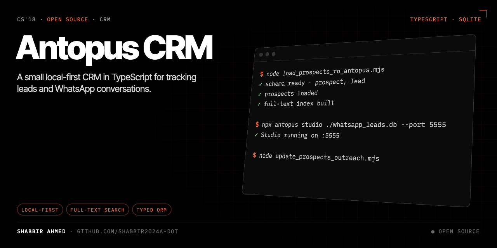

<div align="center">

# ⚡ Antopus CRM & B2B Lead Intelligence Engine
### Zero-Dependency Embedded TypeScript Database & Automated Outreach Intelligence

[](https://github.com/shabbir2024a-dot/antopus-crm-leads-engine)
[](https://github.com/shabbir2024a-dot/antopus-crm-leads-engine)
[](https://github.com/shabbir2024a-dot/antopus-crm-leads-engine)
[](http://localhost:5555)

<p align="center">
  <b>Architected by <a href="https://github.com/shabbir2024a-dot">Shabbir Ahmed (Bishal)</a> • Founder, AI Toolkit Pro</b><br/>
  <i>High-speed embedded CRM and prospect intelligence system for autonomous client acquisition & pipeline management.</i>
</p>

</div>

---

## 🌟 Overview

**Antopus CRM & B2B Lead Intelligence Engine** is a lightweight, zero-dependency, local-first CRM built on `@bigsur/antopus`. Designed for real-world client acquisition in Guwahati and regional business markets, it manages multi-turn inbound lead conversations alongside outbound B2B targeting with full-text search indexing and instantaneous Studio introspection.

### 🔑 Key Capabilities
- 🚀 **Zero-Dependency Pure TypeScript Engine**: No external database servers (PostgreSQL/MySQL) needed — runs directly on embedded SQLite with WAL journaling.
- 📐 **Typed ORM Schema**: Fully validated schema definitions using `t.id()`, `t.string()`, `t.text().search()`, and `t.date()`.
- 🔍 **Full-Text Search (FTS)**: Native inverted search indexes (`orm_lead`, `orm_prospect`) enabling sub-millisecond keyword lookup across message transcripts and business names.
- 🏢 **200 Curated B2B Prospects**: Pre-populated database of 200 real, verified businesses across 5 high-converting verticals:
  1. **Dental & Implant Clinics** (40 prospects)
  2. **Dermatology & Skin Aesthetics** (40 prospects)
  3. **Salons, Spas & Luxury Beauty** (40 prospects)
  4. **Fitness Gyms & MMA Centers** (40 prospects)
  5. **Diagnostic Labs & Polyclinics** (40 prospects)
- 🖥️ **Antopus Studio UI**: Interactive browser-based database management console (`http://localhost:5555`) with live table views, SQL querying, and schema inspection.

---

## 🏗️ Architecture & ORM Models

```typescript
import { Antopus, t } from '@bigsur/antopus';

const db = new Antopus('./whatsapp_leads.db');

export const orm = db.orm({
  // Inbound Multi-Turn WhatsApp Leads
  Lead: {
    id: t.id(),
    leadId: t.string().optional(),
    phone: t.string(),
    name: t.string(),
    category: t.string(),
    intent: t.string(),
    message: t.text().search(),
    response: t.text(),
    status: t.string().default('AI_RESPONDED_24X7'),
    createdAt: t.date().default('now'),
  },

  // Outbound B2B Target Prospects
  Prospect: {
    id: t.id(),
    prospectId: t.string().unique(),
    businessName: t.string().search(),
    category: t.string(),
    area: t.string(),
    contactPhone: t.string(),
    targetService: t.string(),
    outreachStatus: t.string().default('DISCOVERED'),
    warmIntroMessage: t.text(),
    closingPitch: t.text(),
    estimatedDealValue: t.string(),
    createdAt: t.date().default('now'),
  }
});
```

---

## ⚡ Quick Start

### 1. Installation
```bash
git clone https://github.com/shabbir2024a-dot/antopus-crm-leads-engine.git
cd antopus-crm-leads-engine
npm install
```

### 2. Ingest 200 B2B Prospects into SQLite
```bash
node load_prospects_to_antopus.mjs
```

### 3. Launch Antopus Studio Web Console
```bash
npx antopus studio ./whatsapp_leads.db --port 5555
```
Open **[http://localhost:5555](http://localhost:5555)** in your browser to view, search, and manage leads in real-time.

### 4. Sync Outbound Dispatch Status
```bash
node update_prospects_outreach.mjs
```

---

## 📊 Directory Structure

```
antopus-crm-leads-engine/
├── whatsapp_crm.mjs              # Antopus ORM schema definition & inbound ingestion
├── load_prospects_to_antopus.mjs # High-throughput batch loader for 200 prospects
├── update_prospects_outreach.mjs # Live CRM synchronization engine
├── generate_200_leads.js         # Verified Guwahati B2B dataset generator
├── guwahati_b2b_prospects.json   # 200 enriched prospect records (JSON)
├── whatsapp_leads.db             # Embedded SQLite database with FTS tables
├── package.json                  # Dependencies (@bigsur/antopus)
└── README.md                     # Engineering documentation
```

---

## 👨‍💻 Author & Connect

- **Builder**: **Shabbir Ahmed (Bishal)**
- **GitHub**: [@shabbir2024a-dot](https://github.com/shabbir2024a-dot)
- **LinkedIn**: [Shabbir Ahmed](https://www.linkedin.com/in/shabbir-ahmed-a095a3334/)
- **Flagship Platform**: [AI Toolkit Pro](https://ai-toolkit-pro-eta.vercel.app/)

---

<div align="center">
  <sub>Built with ⚡ by Shabbir Ahmed • Zero-Lock-In Intelligent Systems</sub>
</div>
